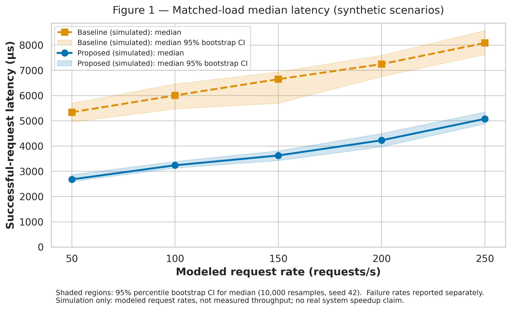
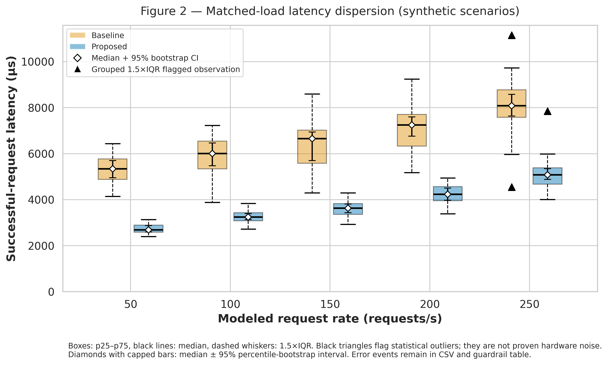

# The Impact of Generative AI on Commercial Visual Artists (2023–2026)

**Course:** Research Methods in IT — Task 3 (Weeks 7–9)
**Authors:** Zhanerke Abdumalik and Zhansaya Baikenova
**Repository:** https://github.com/elvheaven/ai-artist-labor-research
**Research area:** Digital labor, commercial illustration, text-to-image generative AI.

## Executive summary: two distinct strands

This project investigates employment opportunities, human-created asset sales, and creative autonomy using a structured literature-synthesis methodology. It also provides a reproducible **synthetic software-engineering testbed** to demonstrate Task 3 data ingestion, guardrails, bootstrap intervals, visualization, and a formal domain model.

**Do not confuse these strands.** The 260 logged latencies are **generated Gaussian model draws**, *not wall-clock measurements or genuine HTTP throughput*. The 50–250 requests/s labels describe hypothetical load scenarios, not verified achieved RPS. The testbed does **not** prove generative AI's impact on artists or any speedup on real hardware.

The seven before/after study rows in [`data/sample/sample_dataset.csv`](data/sample/sample_dataset.csv) have been explicitly marked `illustrative_unverified`: they were **not extracted as verified source-level data**. They are examples for validating arithmetic and schema, not evidence supporting hypothesis tests. The 11 BibTeX records include peer-reviewed proceedings/journal papers and other research/working-paper material; claiming all are peer-reviewed is unwarranted. See [`docs/Zhansaya_Zhanerke.bib`](docs/Zhansaya_Zhanerke.bib).

## Research questions and evidence boundaries

| Question | Scope | Available material | Current conclusion |
|---|---|---|---|
| **RQ1** — Paid work | Postings, earnings and labor conditions | Literature inventory; 3 illustrative teaching rows | No valid pooled numerical estimate or p-value from provided rows |
| **RQ2** — Human-created sales | Asset listings, sales and policy exposure | Literature inventory; 1 illustrative teaching row | No valid quantitative policy effect or causal claim |
| **RQ3** — Creative autonomy | Artist experiences, workflow changes and decision-making | Qualitative references; 2 illustrative teaching rows | No participant-level counts to run a valid binomial test |
| Context | AI-assisted productivity | 1 illustrative teaching row | Not pooled with earnings, sales or autonomy |

The bibliography itself contains source summaries that can inform a **careful literature discussion**. For instance, the abstract of Demirci, Hannane & Zhu (2025) reports a 17% decline in image creation job postings; Zhou & Lee (2024) describe a 25% creativity-related productivity increase; and Lovato et al. (2024) describe surveying 459 artists. Those are **source-abstract-level statements**, not validations of the fabricated before/after counts in our demo CSV. [BibTeX records](docs/Zhansaya_Zhanerke.bib). Verified effect estimates, sampling frames, and comparable outcomes are required before testing H0 vs H1. Refer to the [methodology passport](docs/methodology_passport.md).

## Architecture and Task 3 file structure

```text
ai-artist-labor-research/
├── data/
│   ├── sample/sample_dataset.csv          # illustrative, unverified study examples
│   ├── raw/test_run.jsonl                 # 260 simulated JSONL records
│   └── processed/
│       ├── benchmark_clean.csv           # 240 evaluation records, including failures
│       └── metrics_summary.csv           # matched-load comparison, CI, guardrail
├── docs/
│   ├── domain_model.md                   # C4 + MCP + LaTeX + notation table
│   ├── methodology_passport.md
│   └── Zhansaya_Zhanerke.bib
├── notebooks/01_data_analysis.ipynb       # executed, outputs saved
├── reports/figures/
│   ├── fig1_latency_vs_load.pdf
│   ├── fig1_latency_vs_load.png
│   ├── fig2_distribution_boxplot.pdf
│   └── fig2_distribution_boxplot.png
├── src/
│   ├── benchmark.py                      # sample audit and synthetic generator
│   ├── process_data.py                   # strict validation, errors, IQR, CI
│   ├── visualize.py                      # two matched-load plots
│   └── make_notebook.py                  # builds + executes notebook
├── tests/test_benchmark.py               # 25 automated tests
├── .gitignore
├── config.json                           # original Task 2 sample-audit config
├── LICENSE
└── README.md
```

**Dockerfile and requirements.txt were deliberately deleted** as requested for the two-person commit sequence. Dependencies are installed explicitly via the command below; Docker isolation is therefore *not* claimed or provided.

## Synthetic benchmark: what is actually evaluated?

The seeded generator (`random.Random(42)` and Gaussian `random.gauss`) creates 20 labeled warm-up records plus 120 Proposed and 120 Baseline evaluation records. Five modeled workload levels have 24 evaluation records per method and load. Their generated latencies reflect different chosen parameters. Thus any apparent lower simulated latency of Proposed is **an assumption-driven scenario contrast**, not independently observed performance.

For statistical integrity, the pipeline:

1. Rejects corrupt JSONL, missing required fields, duplicate IDs, negative latencies, wrong status/error codes, and invalid UTC times instead of silently dropping problematic rows.
2. Excludes explicitly labeled warm-up records from evaluation while preserving raw logs.
3. Saves **all 240** evaluation records to `benchmark_clean.csv` — including failures — and flags but does not remove statistical outliers among successful responses.
4. Computes successful-request latency summaries **conditional on success**, while a separate guardrail includes **all failed requests** in its denominator at every matched workload condition.
5. Uses 10,000 **seeded** percentile-bootstrap draws for each median CI. An interval describes uncertainty of *simulated* sample statistics, not real hardware or artist-market estimates.

### Baseline vs Proposed: generated scenario results

*Units: latency µs; request rate is a **modeled scenario label**, not real measured throughput. Error rates use all benchmark-phase attempts. Latency distributions exclude failed attempts, which remain in the cleaned audit CSV.*

| Condition | n (total/OK) | Errors | Guardrail (≤10%) | Median (p25–p75), µs | Mean ± SD, µs | Median CI95, µs | p95, µs |
| --- | --- | --- | --- | --- | --- | --- | --- |
| Proposed @ 50 RPS | 24/24 | 0.00% | PASSED | 2,682.76 (2,584.99–2,891.46) | 2,742.53 ± 200.43 | [2,598.26, 2,870.03] | 3,043.46 |
| Proposed @ 100 RPS | 24/24 | 0.00% | PASSED | 3,240.47 (3,080.73–3,429.11) | 3,227.37 ± 294.38 | [3,133.83, 3,392.89] | 3,672.68 |
| Proposed @ 150 RPS | 24/24 | 0.00% | PASSED | 3,627.92 (3,360.08–3,829.22) | 3,614.28 ± 379.93 | [3,429.81, 3,812.94] | 4,157.79 |
| Proposed @ 200 RPS | 24/22 | 8.33% | PASSED | 4,230.31 (3,953.42–4,561.65) | 4,262.24 ± 449.89 | [3,972.62, 4,499.85] | 4,931.33 |
| Proposed @ 250 RPS | 24/21 | 12.50% | BREACHED (>10.0%) | 5,079.33 (4,671.28–5,386.57) | 5,197.87 ± 801.21 | [4,884.86, 5,351.76] | 5,989.68 |
| Proposed OVERALL | 120/115 | 4.17% | PASSED | 3,581.30 (3,037.15–4,321.82) | 3,764.74 ± 957.22 | [3,383.50, 3,813.03] | 5,362.20 |
| Baseline @ 50 RPS | 24/24 | 0.00% | PASSED | 5,340.73 (4,878.04–5,768.53) | 5,348.93 ± 656.88 | [4,954.95, 5,698.63] | 6,416.69 |
| Baseline @ 100 RPS | 24/24 | 0.00% | PASSED | 6,009.59 (5,337.75–6,547.88) | 5,927.58 ± 834.41 | [5,474.90, 6,461.40] | 7,162.08 |
| Baseline @ 150 RPS | 24/24 | 0.00% | PASSED | 6,651.00 (5,584.80–7,025.38) | 6,305.20 ± 1,137.50 | [5,698.73, 6,939.87] | 7,832.92 |
| Baseline @ 200 RPS | 24/24 | 0.00% | PASSED | 7,248.78 (6,332.53–7,701.87) | 7,187.98 ± 1,058.14 | [6,757.49, 7,597.04] | 9,005.59 |
| Baseline @ 250 RPS | 24/22 | 8.33% | PASSED | 8,086.84 (7,581.91–8,778.59) | 8,064.03 ± 1,405.00 | [7,630.37, 8,577.20] | 9,727.58 |
| Baseline OVERALL | 120/118 | 1.67% | PASSED | 6,437.09 (5,527.02–7,462.34) | 6,541.37 ± 1,397.35 | [6,064.68, 6,775.82] | 9,116.79 |

**Interpretation:** The modeled Proposed medians are below modeled Baseline medians at the **same** load. Their difference is not an experimentally established speedup. One deliberate Proposed @ 250 RPS failure rate is **12.50%**, above the 10% requirement. A good overall rate (4.17%) does **not** erase this per-load breach. The `--strict` processing mode returns exit code **2** on this condition to support external build validation; the default mode still writes all reports for examination. Neither mode claims a CI/CD server has been configured.

## Scientific visualizations

### Figure 1 — Median latency vs modeled request rate



**Figure 1.** Baseline and Proposed modeled median successful-request latency at identical offered-load labels. Solid blue circles and dashed orange squares distinguish methods even in monochrome; shaded bands are **95% percentile-bootstrap CIs** for the respective simulated medians (B=10,000, seed=42). Units appear on both axes. [Vector PDF](reports/figures/fig1_latency_vs_load.pdf).

### Figure 2 — Matched-load dispersion and outliers



**Figure 2.** Within each load, baseline and proposed boxplots show p25–p75, medians, and 1.5×IQR whiskers. Diamonds and capped bars identify medians and their 95% bootstrap confidence intervals; triangles flag **statistical outliers**, which are not diagnosed hardware faults. Failed events are kept in the CSV/guardrail rather than in success-only boxplots. [Vector PDF](reports/figures/fig2_distribution_boxplot.pdf).

## Installation and reproducibility (Python 3.11+)

Because `requirements.txt` was deliberately removed, install the required libraries directly:

```bash
python -m pip install pandas numpy matplotlib seaborn nbformat nbclient ipykernel jupyter
```

Tested with Python 3.13, pandas 2.2.3, NumPy 2.3.5, matplotlib 3.10.8, seaborn 0.13.2, nbformat 5.10.4 and nbclient 0.10.4. The exact dependency environment is not lockfile-pinned, so it is **not** claimed to be fully deterministic across future library versions.

Run from the **repository root**, in this order:

```bash
python src/benchmark.py --config config.json  # checks illustrative sample; no pooled inference
python src/benchmark.py --generate-raw         # generates deterministic modeled JSONL
python src/process_data.py                    # exports all processed rows and 12 stats rows
python src/visualize.py                       # regenerates 2 PDFs and 2 PNGs
python src/make_notebook.py                   # creates and EXECUTES notebook, saves outputs
python -m unittest discover -s tests -v      # 25 automated tests
```

To deliberately **fail a release guardrail check** after generating the audit CSVs:

```bash
python src/process_data.py --strict
# Expected exit code 2: Proposed @ 250 RPS simulated error rate exceeds 10%.
```

You can also open `notebooks/01_data_analysis.ipynb` and choose **Kernel → Restart & Run All**. All seven code cells in the submitted notebook have saved outputs; code is imported from `src/` rather than duplicated in the notebook. The notebook includes a separate, non-inferential inspection of illustrative research examples.

## Validity, ethical scope and limitations

- **Do not claim** that seven unrelated percent changes establish an average impact of AI on commercial artists; the outcome units and populations are incomparable.
- **Do not claim** the sample teaching numbers reflect the papers by Goldberg & Lam, Hui et al., Jiang et al., Lovato et al., or Makridis without checking the primary full text and its actual tables.
- **Do not claim** that scenario labels are generated live HTTP traffic or that Gaussian draws are stopwatch measurements.
- **Do report** both failure rates and conditional-on-success latencies; statistics from successes alone would conceal selection bias otherwise.
- **Do disclose** the deliberate 250 RPS guardrail breach and the limitations of per-group bootstrap CIs for small correlated/non-independent samples.
- **Next evidence step:** verify and manually extract effect sizes from primary papers; group by RQ and comparable outcome, report actual sample sizes and uncertainty, and only then perform justified hypothesis tests.

## Domain model and bibliography

[**Formal C4 context/components with MCP-0–MCP-3, LaTeX equations and notation**](docs/domain_model.md)
[**Methodology passport: research hypotheses, source verification and guardrail rules**](docs/methodology_passport.md)
[**BibTeX references**](docs/Zhansaya_Zhanerke.bib)

## Suggested citation

```bibtex
@misc{abdumalik2026aiartist,
  title = {The Impact of Generative AI on Commercial Visual Artists:
           Research Methodology and a Synthetic Benchmark Demonstration},
  author = {Abdumalik, Zhanerke and Baikenova, Zhansaya},
  year = {2026},
  howpublished = {GitHub repository},
  url = {https://github.com/elvheaven/ai-artist-labor-research},
  note = {Research Methods in IT, Task 3; synthetic benchmarking data}
}
```

**License:** MIT, see [LICENSE](LICENSE).
