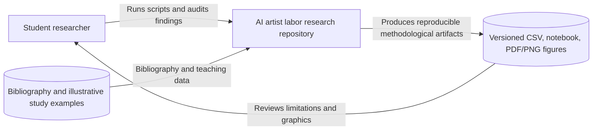
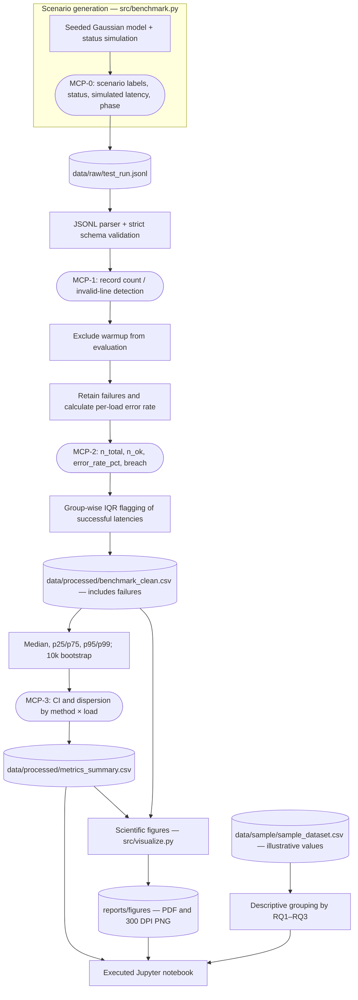

# Domain model — C4 architecture, metric collection points and formal metrics

**Project:** The Impact of Generative AI on Commercial Visual Artists (2023–2026)
**Track:** Software Engineering (SE), with supporting mathematical notation.
**Bibliography:** [`docs/Zhansaya_Zhanerke.bib`](Zhansaya_Zhanerke.bib).

## Scope and crucial boundary

This repository has **two distinct analytical strands**:

1. **Research synthesis:** `data/sample/sample_dataset.csv` contains **illustrative, unverified numbers** associated with RQ1 (paid work), RQ2 (asset sales), and RQ3 (creative autonomy). The before/after counts are teaching examples, **not quotations from publications**. The BibTeX entries identify relevant literature but do not authenticate these invented counts.
2. **Task 3 IT testbed:** `src/benchmark.py --generate-raw` creates **synthetic** JSONL latency/error events for a hypothetical baseline and proposed workflow. This is useful for demonstrating data cleaning, confidence intervals, validation, and charts. It does **not** send real requests at 50–250 RPS, time a live algorithm, or establish labor-market effects.

The technical benchmark is a methodological demonstration of the research pipeline, **not empirical evidence for hypotheses RQ1–RQ3**.

## 1. C4 level 1: System context

## 2. C4 level 2/3: Containers/components and MCPs

The **metric collection points (MCP)** are stages in a simulated data-processing system, not instrumented live network probes.

**Trust/reproducibility boundaries:** malformed JSONL is rejected; the warm-up phase is excluded from evaluation; failed requests remain in the processed audit dataset; successful-request latencies are reported **conditional on success**, accompanied by an explicit failure-rate guardrail. Outlier flags do not remove records. `--strict` exits with code 2 on a breach.

## 3. Mathematical formalization (LaTeX)

For a *comparable* outcome in one study with nonzero before value:

$$\Delta_i = 100\frac{Y_{i,\mathrm{after}}-Y_{i,\mathrm{before}}}{Y_{i,\mathrm{before}}}\%.$$

**Do not pool** $\Delta_i$ from earnings, counts of jobs, creative-autonomy ratings, and productivity into a single meaningful estimate. The seven sample rows are illustrative and therefore **no t-test, Wilcoxon test or binomial p-value is reported**. Authentic study-level estimates, corresponding uncertainties, sample sizes, and harmonized outcome definitions would be required first.

Given $N_W$ *evaluation-phase* requests in scenario stratum $W=(\mathrm{method},\mathrm{load\_rps})$, with error indicator $e_j$:

$$E_W=100\frac{\sum_{j\in W}e_j}{N_W}\%,\qquad e_j=\mathbf{1}(\mathrm{status}_j\neq\mathrm{ok}).$$

The guardrail **passes** only if $E_W \leq 10\%$ for *every* individual workload stratum. A passing global aggregate never overrides a breach.

For the $n_W$ **successful** latencies, median and IQR are:

$$\tilde{x}_W=\operatorname{median}(x_1,\ldots,x_{n_W}),\qquad \operatorname{IQR}_W = Q_{0.75,W}-Q_{0.25,W}.$$

An observation is **flagged, not discarded**, if it lies outside

$$[Q_{0.25,W}-1.5\operatorname{IQR}_W,\;Q_{0.75,W}+1.5\operatorname{IQR}_W].$$

The 95% percentile-bootstrap CI is computed using $B=10{,}000$ resamples with replacement (seed 42):

$$\mathrm{CI}_{95\%}(\tilde{x}_W)=\left[Q_{0.025}(\{\tilde{x}_W^{*b}\}_{b=1}^B),\;Q_{0.975}(\{\tilde{x}_W^{*b}\}_{b=1}^B)\right].$$

The bootstrap interval quantifies the variability of the **simulated model outputs**, not uncertainty about real systems or artist-market outcomes.

| Symbol | Definition | Unit |
|---|---|---|
| $Y_{i,\mathrm{before}},Y_{i,\mathrm{after}}$ | Comparable within-study values | Outcome-specific |
| $\Delta_i$ | Relative change for one well-defined outcome | % |
| $W$ | Simulation method × offered-load scenario | method, modeled req/s |
| $N_W$ | All evaluation attempts, successful and failed | count |
| $n_W$ | Successful evaluation attempts | count |
| $E_W$ | Failure rate including non-2xx simulated status | % |
| $x_j$ | Simulated latency, *not stopwatch timing* | µs |
| $Q_p$ | Empirical percentile of successful latency samples | µs |
| $B$ | Number of bootstrap resamples | count |
| $\tau$ | Maximum allowed error rate | 10% |

## 4. Entities and invariants

| Domain entity | Responsibility |
|---|---|
| `StudyExample` | One *illustrative*, source-linked (but unverified) example classified as RQ1, RQ2, RQ3 or CONTEXT |
| `BenchmarkScenario` | Seed, workload label, baseline/proposed model assumptions |
| `MeasurementLog` | Timestamped simulated run with phase, status, error code and latency |
| `GuardrailResult` | Condition-specific pass/breach with failures in denominator |
| `SummaryStatistics` | Conditional-on-success statistics with bootstrap intervals |
| `ScientificFigure` | Matched-load baseline/proposed comparison in PDF and 300 DPI PNG |

**Invariants:** every JSONL line must be valid; run IDs unique; timestamps explicitly UTC; latency non-negative; status/error-code consistent; warm-up does not enter evaluation; errors are counted rather than silently dropped; outliers remain in cleaned data; random seeds are fixed; results must be described as synthetic.
